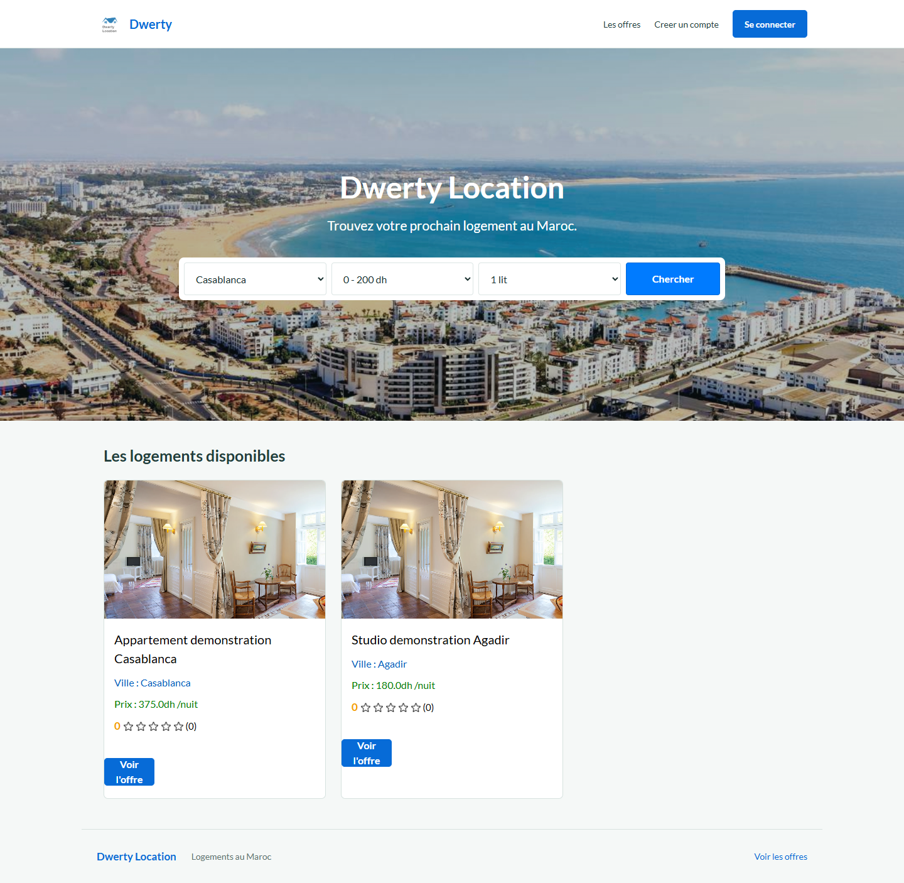
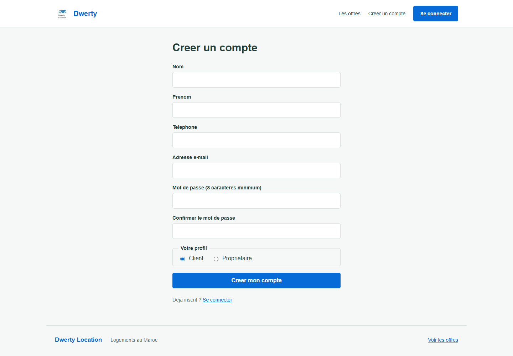
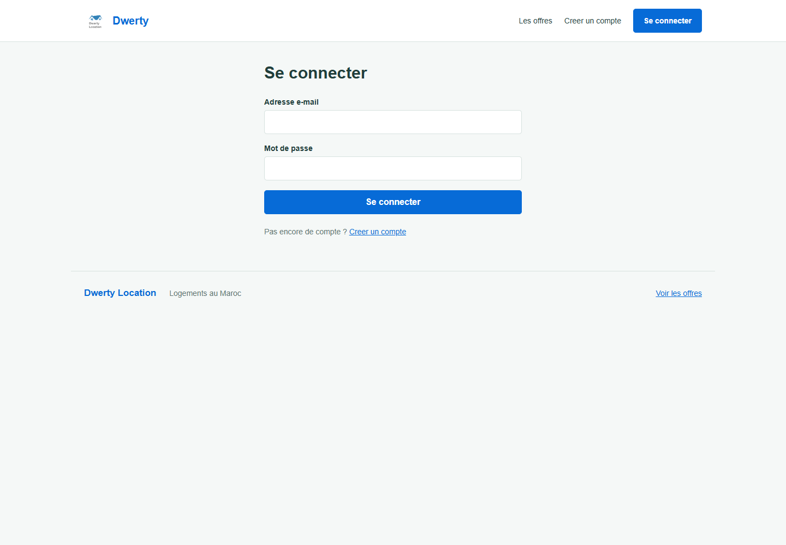
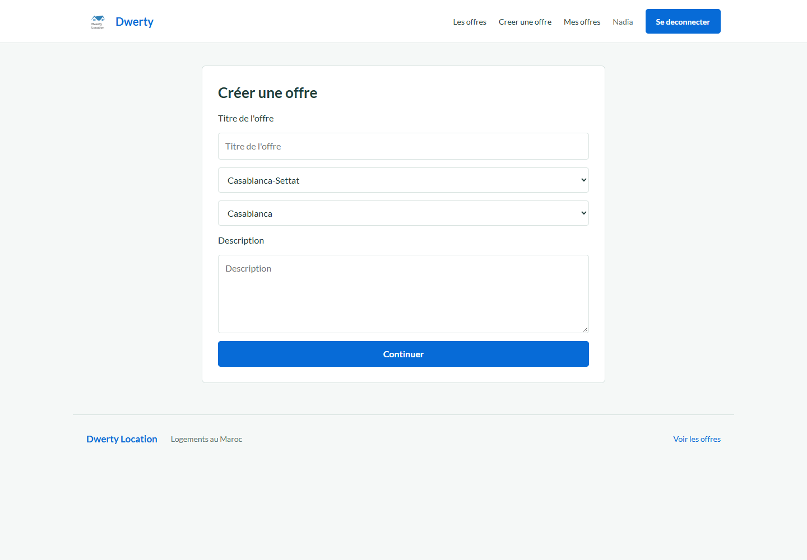
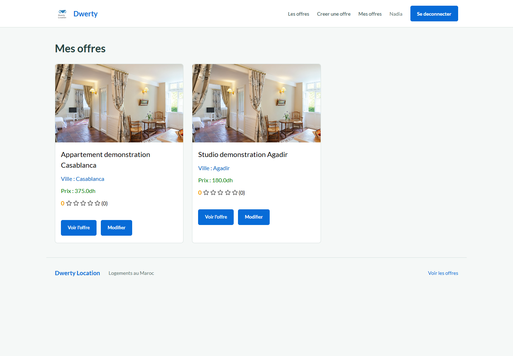
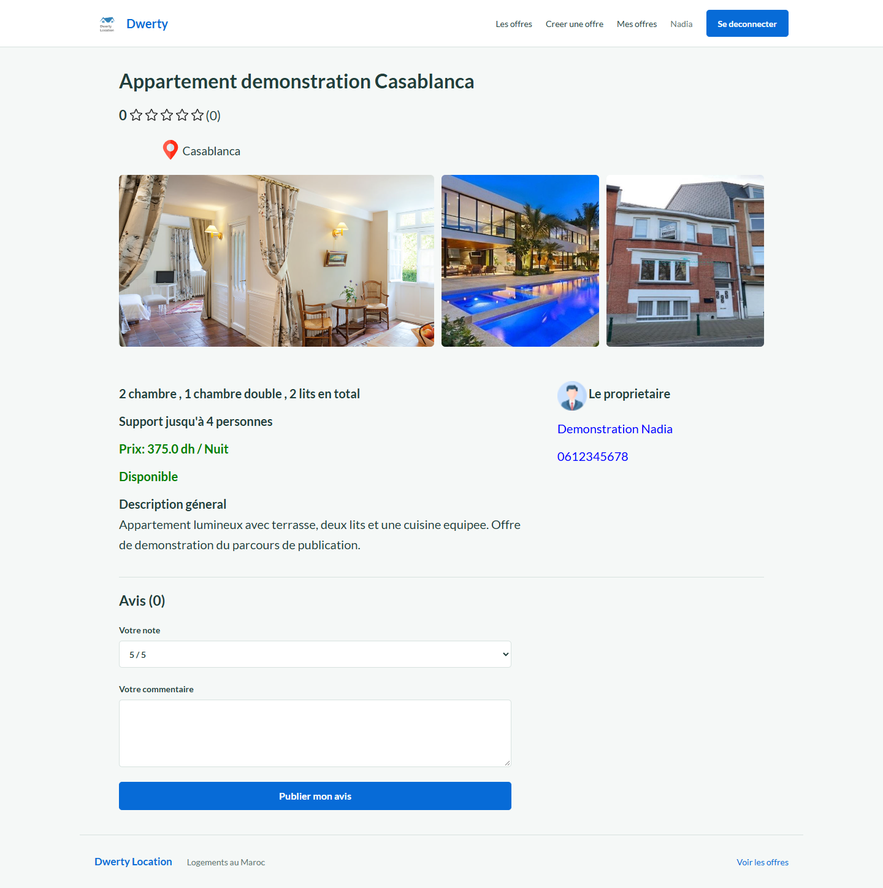

# Dwerty Location

Application web de recherche et de publication de logements au Maroc. Les visiteurs
consultent les annonces, les clients disposent d'un compte et les propriétaires
publient et gèrent leurs offres.



## Démarrage rapide

**Prérequis :** Git et Docker Desktop démarré avec les conteneurs Linux et Docker Compose.
Java, Maven, Tomcat et MySQL sont fournis par les images Docker.

```sh
git clone https://github.com/soufianebt/Dwerty-Location.git
cd Dwerty-Location
docker compose up --build -d
```

Ouvrir **http://localhost:8080**. Le premier démarrage peut prendre quelques minutes
pour télécharger les images et les dépendances Maven.

La base est initialement vide : créer un compte **Propriétaire**, puis publier une
première offre pour alimenter l'accueil. Les comptes, annonces et photos présents
dans les captures sont des données de démonstration locales, **pas des données
préchargées** par le dépôt. Les photos illustrent le parcours et ne représentent pas
une annonce immobilière réelle.

## Rôles et fonctionnalités

| Rôle | Fonctionnalités |
| --- | --- |
| Visiteur | Consulter les offres, rechercher par ville, budget et nombre de lits, ouvrir les détails et créer un compte. |
| Client connecté | Consulter les offres, laisser une note et un commentaire, se déconnecter. |
| Propriétaire connecté | Fonctionnalités du client, publication en trois étapes, consultation de « Mes offres » et modification de ses annonces. |

La publication est réservée aux propriétaires. Les pages privées demandent une
connexion, et une annonce ne peut être modifiée que par son propriétaire.

## Cas d'utilisation illustrés

### 1. Rechercher un logement

Depuis l'accueil, sélectionner une ville, une tranche de prix et un nombre de lits,
puis cliquer sur **Chercher**. Chaque résultat présente une photo, la ville, le prix
par nuit et la note moyenne. **Voir l'offre** ouvre la fiche détaillée.

La capture de l'accueil en haut de ce document montre la recherche et les annonces disponibles.

### 2. Créer un compte

1. Cliquer sur **Créer un compte** dans la navigation.
2. Renseigner le nom, le prénom, le téléphone et l'adresse e-mail.
3. Saisir et confirmer un mot de passe d'au moins huit caractères.
4. Choisir **Client** pour consulter les offres ou **Propriétaire** pour en publier.
5. Valider le formulaire, puis se connecter après la confirmation.

Les mots de passe différents, les champs invalides et une adresse e-mail déjà
utilisée produisent un message dans le formulaire. Les nouveaux mots de passe sont
hachés avec BCrypt ; leur taille est limitée à 72 octets côté serveur.



### 3. Se connecter et se déconnecter

Saisir l'adresse e-mail et le mot de passe dans **Se connecter**. Après validation,
l'application revient à l'accueil et adapte la navigation au profil connecté.
Un mauvais mot de passe affiche une erreur sans quitter le formulaire.

Le bouton **Se déconnecter** ferme la session. Les pages privées ne sont ensuite
plus accessibles sans une nouvelle connexion.



### 4. Publier une offre

Avec un compte propriétaire, cliquer sur **Créer une offre** et compléter les trois étapes :

1. **Présentation :** titre, région, ville et description.
2. **Logement :** chambres, chambres doubles, lits, prix par nuit, date de disponibilité et capacité.
3. **Photos :** ajouter trois images JPEG ou PNG, puis cliquer sur **Publier l'offre**.

Les images sont limitées à 10 Mo par fichier. Après enregistrement, la page
**Mes offres** affiche une confirmation. L'annonce est également consultable sur
l'accueil et dans les résultats de recherche correspondant à ses critères.



### 5. Consulter et modifier ses offres

Ouvrir **Mes offres** pour retrouver uniquement ses annonces. **Voir l'offre** ouvre
la fiche publique ; **Modifier** permet de mettre à jour les informations du logement,
son prix, sa description et sa disponibilité. L'enregistrement revient à la liste
avec une confirmation.

Si aucune annonce n'existe, un état vide propose au propriétaire d'en créer une.



### 6. Consulter les détails et laisser un avis

La fiche présente les trois photos, les caractéristiques du logement, le prix, la
disponibilité, la description et les coordonnées du propriétaire.

Un utilisateur connecté peut choisir une note de 1 à 5 et publier un commentaire.
Un visiteur non connecté voit une invitation à se connecter pour laisser un avis.



## Technologies

| Composant | Technologie |
| --- | --- |
| Langage et compilation | Java 25 LTS (Eclipse Temurin) et Maven, application empaquetée en WAR |
| Serveur web | Apache Tomcat 9, Servlet 4 avec `javax.servlet` |
| Vues | JSP, JSTL, Bootstrap et feuilles CSS externes |
| Persistance | Hibernate ORM 5.6.15.Final, Connector/J 9.7.0 et MySQL 8.4 |
| Tests | JUnit 6.1.3 et Maven Surefire 3.6.0 |
| Authentification | Sessions HTTP et BCrypt pour les nouveaux comptes |
| Exécution locale | Dockerfile multi-stage et Docker Compose |

Tomcat 10+ utilise `jakarta.servlet` et nécessite une migration : il ne remplace pas
directement Tomcat 9 pour ce projet.

### Compatibilité et mises à jour

La compilation utilise `maven.compiler.release=25`. L'image de construction utilise
Maven 3.10.0 avec Eclipse Temurin 25 et l'image d'exécution utilise Tomcat 9 avec
Eclipse Temurin JDK 25. Maven Compiler 3.14.1 et Maven WAR 3.5.1 assurent la compilation
et l'empaquetage. Byte Buddy 1.18.15 et JAXB Runtime 2.3.9 remplacent leurs anciennes
versions transitives pour l'exécution sur les JDK récents.

`hibernate-entitymanager` (fusionné dans Hibernate Core), Hibernate Validator et
Javassist ont été retirés : les deux derniers n'étaient pas utilisés dans le code.
Les API Servlet 4, JSP 2.3 et JSTL 1.2 restent dans leur dernière branche compatible
avec `javax` et Tomcat 9.

**Limite de support :** Hibernate 5.6 ne reçoit plus de maintenance communautaire.
Cette mise à jour conserve `javax.persistence` ; passer à un Hibernate maintenu
nécessite une migration distincte vers Jakarta Persistence et les API de requêtes
correspondantes. Elle ne constitue pas une migration complète vers Jakarta EE.

Les dépendances directes et transitives résolues ont été contrôlées via les avis
GitHub lors de la mise à jour : aucun avis connu n'a été signalé pour les versions
vérifiées. Ce résultat dépend de la couverture et de la date du scan ; il ne
garantit pas l'absence de vulnérabilités et ne couvre pas l'image système Docker.

### Exécuter les tests

La construction Docker exécute les tests JUnit avant de créer le WAR. Pour isoler
la compilation et relancer les tests sans installer Java ou Maven localement :

```sh
docker build --target build -t dwerty-location-build .
docker run --rm dwerty-location-build mvn -B test
```

Les trois tests actuels couvrent l'association photo/annonce et l'image de repli.
Ils ne remplacent pas les vérifications des parcours avec Tomcat et MySQL.

## Configuration Docker

Le service `app` compile le WAR avec Maven avant de le déployer à la racine de
Tomcat. Le service `db` démarre MySQL ; Compose attend une requête de contrôle
réussie avant de lancer l'application. Hibernate crée ou met à jour le schéma lors
de la première connexion à la base.

Un fichier `.env` facultatif à la racine permet de modifier les paramètres suivants :

```dotenv
APP_PORT=8080
DB_PASSWORD=remplacer-par-un-mot-de-passe-application
DB_ROOT_PASSWORD=remplacer-par-un-autre-mot-de-passe-root
```

Le fichier `.env` est ignoré par Git. Sans surcharge, Compose utilise des mots de
passe de développement. MySQL reste sur le réseau interne de Compose ; seul le
port HTTP de l'application est publié, sur `127.0.0.1`.

Les variables `DB_URL`, `DB_USERNAME`, `DB_PASSWORD` et `DB_DIALECT` remplacent les
valeurs locales de Hibernate dans les conteneurs. `UPLOAD_DIR` désigne le répertoire
des photos, monté dans le dossier `/img` de l'application. Les fichiers multipart
temporaires utilisent le répertoire temporaire de Tomcat.

### Commandes utiles

```sh
# Consulter l'état des services et leurs journaux
docker compose ps
docker compose logs -f app db

# Reconstruire après une modification du code ou des JSP/CSS
docker compose up --build -d

# Arrêter les services sans supprimer les données
docker compose down
```

Les volumes `mysql_data` et `uploads` conservent la base et les photos.
**Attention : `docker compose down -v` supprime définitivement ces deux volumes.**

Les paramètres d'initialisation MySQL ne s'appliquent qu'à un nouveau volume.
Modifier un mot de passe dans `.env` après initialisation nécessite aussi de
modifier le compte correspondant dans MySQL.

## Structure du projet

```text
src/main/java/com/dwirty/
	beans/          Entités et objets de données
	controllers/    Servlets et filtre d'authentification
	crud/           Interface d'accès aux données
	gestion/        Accès Hibernate et présentation des offres
src/main/resources/hibernate.cfg.xml
src/main/webapp/
	css/            Styles séparés des JSP et du code Java
	WEB-INF/jspf/   Navigation et pied de page communs
	WEB-INF/web.xml Configuration des servlets
docs/screenshots/ Captures des cas d'utilisation
Dockerfile
compose.yaml
```

## Vérifications et limites

Les parcours d'inscription, connexion refusée/réussie, déconnexion, restriction de
publication, création avec trois photos, modification et recherche ont été exercés
sur l'instance Docker locale. Les pages principales ont également été contrôlées
aux formats bureau et mobile. Ces vérifications de parcours ne constituent pas une
suite complète de tests automatisés ou un audit de sécurité.

Cette configuration vise le **développement local**. Une mise en production
nécessite une revue de sécurité, une gestion adaptée des secrets, HTTPS, des
sauvegardes et une stratégie de migration de schéma à la place du mode Hibernate
`update`.
